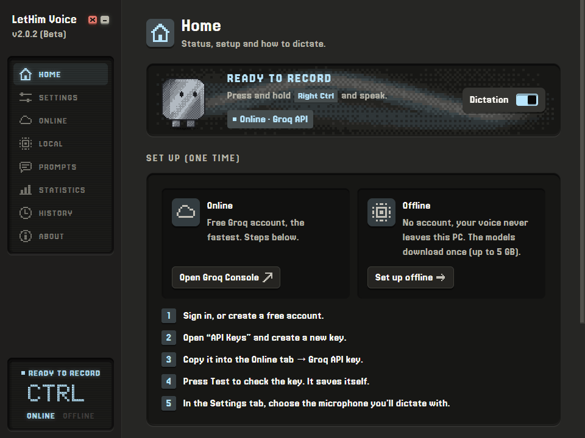

# LetHim Voice

Push-to-talk dictation for Windows, macOS and Linux. Hold a key, speak, let go: the
text appears where your cursor is, cleaned up and ready to send.




## What it does

- **Dictate anywhere.** Hold the shortcut (right <kbd>Ctrl</kbd> on Windows and
  Linux, right <kbd>⌘</kbd> on macOS), speak, release. A small pill shows that it
  listens, and the text is pasted into the app you were using.
- **Online or offline.**
  - *Online* uses the Groq API with your own free API key. It is the fastest.
  - *Offline* runs Whisper speech models and an optional Gemma cleanup model on your
    computer (whisper.cpp and llama.cpp, GPU or CPU). Your voice never leaves the
    machine. The models download once, up to 5 GB.
- **Modes.** Clean, Email, Chat, To Do List, Rewrite, Assistant, Translate and Raw,
  plus modes you write yourself.
- **Languages.** Dictation in English, French, Spanish, German, Slovak, Czech, Polish,
  Ukrainian and Russian. The interface is in English, Czech, Polish, Slovak and
  Ukrainian.
- **History and statistics.** Your recent dictations and time saved, kept only on
  your computer. History can be turned off.
- **Updates itself.** The app checks GitHub Releases and installs a new version
  when you restart it.

## Install

Download the latest version from [Releases](https://github.com/svbast/lethimvoice/releases/latest).

| System | File | Updates itself |
| --- | --- | --- |
| Windows 10 and 11 | `…-win-x64-installer.exe` | yes |
| Windows, no install | `…-win-x64-portable.exe` | no, it tells you when a new version is out |
| macOS, Apple Silicon | `…-mac-arm64.dmg` | yes |
| macOS, Intel | `…-mac-x64.dmg` | yes |
| Linux | `.AppImage`, `.deb`, `.rpm` (x64 and arm64) | yes |
| Linux | `.tar.gz` | no |

### First launch

The builds are not signed by Microsoft or notarized by Apple yet, so the system
warns you once.

- **Windows:** "Windows protected your PC" → **More info** → **Run anyway**.
- **macOS:** open the app once, then go to **System Settings → Privacy & Security**
  and click **Open Anyway**. Then allow **Microphone** and **Accessibility**: the
  shortcut and the paste need them.
- **Linux:** make the AppImage executable (`chmod +x`). On Wayland the desktop asks
  you once to pick the shortcut (it can't bind right Ctrl alone) and once to allow
  the paste ("Remote Interaction").

### Set it up

The Home tab walks you through it:

- **Online:** create a free key in the [Groq Console](https://console.groq.com) and
  paste it in the Online tab.
- **Offline:** open the Local tab and download the recommended models.

## Privacy

- **Online mode:** your recording and its text go to Groq to be transcribed and
  cleaned up.
- **Offline mode:** nothing leaves your computer.
- **Your API key:** stored encrypted with your system's keychain when one is
  available.
- **No telemetry:** the app does not collect any. The only other places it connects
  to:
  - GitHub, for updates and the offline engines;
  - Hugging Face, for the offline models.

## Build from source

You need [Bun](https://bun.sh).

```sh
bun install
bun run dev     # the app with live reload
bun run build   # installers in release/
```

See [CONTRIBUTING.md](CONTRIBUTING.md) for the checks a pull request has to pass.

## Contributing and security

Bug reports, ideas and pull requests are welcome; see [CONTRIBUTING.md](CONTRIBUTING.md)
and the [Code of Conduct](CODE_OF_CONDUCT.md). Please report security problems
privately, as described in [SECURITY.md](SECURITY.md).

## Credits

Made by [svbast](https://github.com/svbast).

## License

[GPL-3.0](LICENSE). The bundled Jersey 20 font is under the
[SIL Open Font License](src/assets/fonts/OFL.txt).
